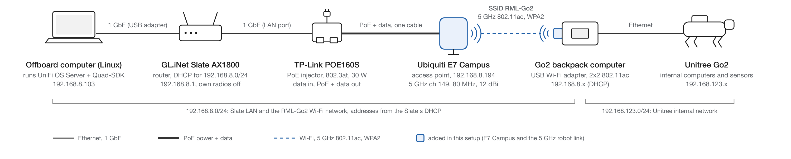

# :material-wifi: Go2 Field Wi-Fi (E7 Campus)

A long-range, high-rate Wi-Fi link between the lab laptop and a Go2 for field experiments. The GL.iNet Slate's own radio did not give enough range or sustained throughput for closed-loop control, so a Ubiquiti **E7 Campus** outdoor access point now carries the robot link. The router stays the router; the E7 is only a radio. Everything below was set up and verified on 2026-10-14.

{ loading=lazy }

*The wired chain feeds the E7; the robot joins it over 5 GHz and bridges to its own `192.168.123.x` network over Ethernet. Vector source: [go2-field-wifi.svg](../assets/rml/go2-field-wifi.svg).*

!!! info "What runs where"
    The **lab laptop** (`192.168.8.103`, Linux) hosts **UniFi OS Server**, the controller that configures the E7, and runs the Quad-SDK remote driver. The E7 keeps its configuration and keeps serving Wi-Fi when the laptop or the controller is off — the controller is only needed to change settings or look at client statistics.

## Hardware

| Device | Role | Notes |
|---|---|---|
| **Lab laptop** (Linux) | UniFi OS Server + Quad-SDK remote driver | `192.168.8.103`, wired to a router LAN port |
| **GL.iNet Slate AX1800** | Router, DHCP for `192.168.8.0/24` | `192.168.8.1`. Two LAN ports, both used. 5 GHz radio **off** (see note below). |
| **TP-Link POE160S** | PoE injector between the router and the E7 | 802.3at, 30 W — **under-spec for the E7**, see below |
| **Ubiquiti E7 Campus** | Outdoor WiFi 7 access point, 4x4 on 5 GHz, 12 dBi directional antenna | `192.168.8.194`, firmware 8.7.11. 10G port used, 1G port empty. |
| **Go2 backpack computer** | Robot-side computer carrying the USB Wi-Fi adapter | 2x2 802.11ac (AC1300 class) |
| **Unitree Go2** | Robot | Internal `192.168.123.x` network ([Network & IP map](networking.md)) |

!!! tip "Field router vs. lab mocap router"
    In the field the GL.iNet Slate is the router. In the lab the E7 can hang off the mocap TP-Link instead — both hand out `192.168.8.0/24`, so nothing else changes. Never put both routers on the same wire.

## Cabling

1. Injector **PoE** port → E7 **10G** port. Leave the E7's 1G port empty; it is a failover uplink, not a LAN port.
2. Injector **data/LAN** port → a router **LAN** port (not WAN — WAN is the router's upstream side and runs no DHCP).
3. Lab laptop → the router's other LAN port.
4. Router WAN → campus network only if you want internet on that segment. Optional.
5. Injector indoors or in an enclosure (rated 0–40 °C). The E7 itself is rated to −30 °C.

!!! note "Turn the Slate's 5 GHz radio off"
    On the Slate's admin page (`http://192.168.8.1` → **Wireless**) switch the **5 GHz** radio **off**. Left on, it competes for airtime with the E7 on the same band, and a robot that still has the Slate's SSID saved can fall back to it without any obvious sign. The 2.4 GHz radio can stay on for admin access from a phone.

!!! danger "The POE160S is the wrong injector for an E7 Campus"
    The E7 Campus needs **802.3bt PoE++** and draws about 44 W at full power. The POE160S is an 802.3at injector with a 30 W ceiling. The AP boots on it (booting needs far less than the radios) and currently runs with the 2.4 GHz and 6 GHz radios disabled to trim the draw, but a drop-out under sustained load is possible. **Replace it with a TP-Link POE170S or Ubiquiti U-PoE++ (60 W)** — see [open items](#open-items).

!!! warning "Why adoption fails if you wire the laptop straight into the AP"
    The E7 is only an access point. Nothing on a laptop-to-AP cable runs DHCP: the laptop self-assigns `169.254.x.x`, the AP falls back to `192.168.1.20`, and the controller never sees it. Always put the router between them.

## Addresses

| Device | Address | Assigned by |
|---|---|---|
| GL.iNet Slate (router, DHCP, DNS) | `192.168.8.1` | Fixed |
| Lab laptop (UniFi OS Server, remote driver) | `192.168.8.103` | Router DHCP — **reserve it** |
| E7 Campus | `192.168.8.194` | Router DHCP — **reserve it** |
| Go2 backpack computer, Wi-Fi | `192.168.8.x` | Router DHCP — **reserve it** (use the fleet addresses from the [Lab Hub](index.md#lab-fleet)) |
| Go2 backpack computer, wired `eth0` | `192.168.123.x` | Static netplan, see [Network & IP map](networking.md#connecting-the-internet-directly-to-the-robot) |

The AP sends its management traffic to the laptop's address. If that address changes, UniFi shows the AP as *disconnected* until it learns the new one (the AP keeps serving Wi-Fi meanwhile). Reserving the laptop's address on the router prevents this. On the GL.iNet admin page (`http://192.168.8.1`) use *Clients → Bind*; on the TP-Link remember to fill the DNS field or the reservation silently fails.

## UniFi OS Server on the lab laptop

UniFi OS Server is Ubiquiti's self-hosted controller. It runs in a Podman container and serves its UI on port **11443**; devices talk to it on port **8080**.

### Install (Ubuntu / Debian, x86-64)

Requirements from Ubiquiti's [help article](https://help.ui.com/hc/en-us/articles/34210126298775): Ubuntu 23.04+ or Debian 12+, systemd, podman ≥ 4.3.1, slirp4netns ≥ 1.2, 2 GB RAM, 10 GB free. Community guides report it working on Ubuntu 22.04 and 24.04 as well.

```bash
sudo apt-get update && sudo apt-get install -y podman slirp4netns uidmap
# Get the current "Linux x64" installer link from https://ui.com/download/releases/unifi-os-server
wget -O uos-server.bin "<installer URL>"
chmod +x uos-server.bin
sudo ./uos-server.bin
```

Then open `https://localhost:11443` on the laptop, run the setup wizard (console name, local admin account), and in the **Network** app set **Settings → System → Country** to *United States* — this gates the channels and power levels the AP may use.

### Adopt the E7

1. Cable everything as above and power the injector. The E7 LED goes flashing white (booting) then **steady white** (ready to adopt). Blue means adopted.
2. In the Network app, **Devices** lists the E7 as *Ready to adopt* within a minute. Click **Adopt**. The server then pushes a firmware upgrade, which takes the AP offline for about three minutes — wait it out.
3. **Settings → System → Advanced → Inform Host**: enable the override and enter `192.168.8.103`. The controller runs in a container, and without this it can advertise an internal address to the AP and adoption loops.
4. If the AP never appears, find its address in the router's client list and point it at the laptop by hand (factory SSH login is `ubnt` / `ubnt` only *before* adoption):

    ```bash
    ssh ubnt@<ap-ip>
    set-inform http://192.168.8.103:8080/inform
    ```

5. If it is wedged from an earlier attempt, hold the AP's reset button for ten seconds and repeat.

After adoption the server replaces the factory SSH login with its own device credentials, shown under **Settings → System → Device SSH Authentication**. With those, `ssh <user>@192.168.8.194` works; `mca-cli-op info` shows the AP's status and `iw dev` the live radios and SSIDs.

## Wi-Fi network and radio settings

One network, **`RML-Go2`**, on the 5 GHz radio only. Set these in the Network app under **Settings → WiFi** (the network) and **Devices → E7 Campus → Radios** (the radios).

| Setting | Value | Why |
|---|---|---|
| SSID | `RML-Go2`, visible | Plain name; hidden SSIDs only slow the client's scanning |
| Security | WPA2-PSK (AES), WPA3 **off**, PMF **off** | Realtek-based 802.11ac USB adapters misbehave on WPA3 and management-frame protection |
| Passphrase | `rml-go2-field-2026` | Lab-internal; change under Settings → WiFi if needed |
| Band | 5 GHz only | Keeps the robot off 2.4 GHz |
| 5 GHz channel | **149**, fixed | Non-DFS, so no radar-triggered channel change mid-experiment; UNII-3 allows the highest outdoor power in the US |
| Channel width | **80 MHz** | The most a 2x2 802.11ac client uses; wider gains nothing and raises interference exposure |
| Transmit power | High (24 dBm conducted + 12 dBi antenna) | Maximum allowed |
| 2.4 GHz radio | Disabled | No competing beacons, lower power draw |
| 6 GHz radio | Disabled | No 6 GHz clients, lower power draw |
| Client isolation | Off | Laptop and robot must talk directly |
| Multicast / broadcast filtering | Off | DDS discovery (ROS 2, Unitree SDK) uses multicast |
| Multicast enhancement | Off | Leave off unless discovery proves slow |
| 802.11r fast roaming, 802.11v BSS transition | Off | Single AP; some clients misbehave with them on |
| UAPSD | Off | Power-save feature that adds latency |
| Nightly channel optimization (Settings → WiFi → Global AP settings) | Off | The AP must never move channel on its own |
| Element adoption network, wireless meshing (Settings → System) | Off | Removes two hidden system SSIDs from the air |

??? example "Same settings through the API (optional, reproducible)"
    Create an API key under **Settings → Control Plane → Integrations**. These calls target the legacy Network API on the laptop; `<apgroup>`, `<usergroup>` and `<network>` ids come from `rest/apgroup` (v2: `/v2/api/site/default/apgroups`), `rest/usergroup` and `rest/networkconf`, and `<device-id>` from `stat/device`.

    ```bash
    KEY=<api key>
    B=https://localhost:11443/proxy/network/api/s/default
    H=(-sk -H "X-API-KEY: $KEY" -H "Content-Type: application/json")

    # Wi-Fi network
    curl "${H[@]}" -X POST "$B/rest/wlanconf" -d '{"name":"RML-Go2","enabled":true,
      "security":"wpapsk","wpa_mode":"wpa2","wpa_enc":"ccmp","x_passphrase":"rml-go2-field-2026",
      "wlan_bands":["5g"],"ap_group_ids":["<apgroup>"],"ap_group_mode":"all",
      "usergroup_id":"<usergroup>","networkconf_id":"<network>","hide_ssid":false,
      "pmf_mode":"disabled","wpa3_support":false,"bss_transition":false,
      "fast_roaming_enabled":false,"uapsd_enabled":false,"l2_isolation":false,
      "bc_filter_enabled":false,"mcastenhance_enabled":false,"setting_preference":"manual"}'

    # Radios: 2.4 GHz off, 5 GHz ch149/80 MHz/high, 6 GHz off
    curl "${H[@]}" -X PUT "$B/rest/device/<device-id>" -d '{"radio_table":[
      {"radio":"ng","name":"wifi0","channel":"auto","ht":"20","tx_power_mode":"disabled"},
      {"radio":"na","name":"wifi1","channel":"149","ht":"80","tx_power_mode":"high"},
      {"radio":"6e","name":"wifi2","channel":"auto","ht":"160","tx_power_mode":"disabled"}]}'

    # Hidden system SSIDs off (ids from rest/setting)
    curl "${H[@]}" -X PUT "$B/rest/setting/element_adopt/<id>" -d '{"enabled":false}'
    curl "${H[@]}" -X PUT "$B/rest/setting/connectivity/<id>" -d '{"enabled":false}'
    ```

Verified on the AP after provisioning: `iw dev` lists only `RML-Go2`, on channel 149 (5745 MHz) at 80 MHz and 24 dBm, and the 2.4 GHz and 6 GHz radios carry nothing.

## Robot side (Go2 backpack computer)

The backpack computer's USB Wi-Fi adapter joins `RML-Go2`. Its wired `eth0` stays on the robot's internal `192.168.123.x` network exactly as in the [Network & IP map](networking.md#required-ip-assignments).

1. Join the network and turn Wi-Fi power saving **off** — the largest latency and jitter source on USB adapters:

    ```bash
    nmcli dev wifi connect RML-Go2 password rml-go2-field-2026
    sudo tee /etc/NetworkManager/conf.d/wifi-powersave.conf >/dev/null <<'EOF'
    [connection]
    wifi.powersave = 2
    EOF
    sudo systemctl restart NetworkManager
    iw dev wlan0 get power_save    # expect: Power save: off
    ```

2. Forget the Slate's old SSID so the robot cannot fall back to it: `nmcli connection delete <old name>`.
3. Driver: if the adapter uses a Realtek RTL8812BU or RTL8814AU chip, build the maintained out-of-tree driver ([morrownr 88x2bu](https://github.com/morrownr/88x2bu-20210702) or [8814au](https://github.com/morrownr/8814au)) against the Jetson kernel. The driver on the bundled disc is usually old.
4. Reserve the robot's Wi-Fi address on the router so scripts can use a fixed IP.
5. Reaching the robot's internal computers from the laptop: the backpack computer sits on both networks. If laptop code must talk to `192.168.123.x` directly, enable forwarding on the backpack computer and add a route on the laptop. Code that runs on the backpack computer itself needs none of this.

    ```bash
    # on the backpack computer
    sudo sysctl -w net.ipv4.ip_forward=1
    # on the laptop
    sudo ip route add 192.168.123.0/24 via <robot Wi-Fi IP>
    ```

6. As always, `source launch_robot_env.sh` before `ros2 launch quad_utils robot_driver.py` and check that it reports the right subnets on both interfaces.

## Verification

Check the link before trusting it in an experiment. Targets are for the robot at the far edge of the test area.

| Check | Where | Expect |
|---|---|---|
| Signal | Network app → Clients → the robot's row | RSSI better than −67 dBm, channel 149 at 80 MHz, negotiated rate of several hundred Mbps |
| Latency and jitter | Laptop: `ping -i 0.2 <robot IP>` for a minute | A few ms average, no loss, no spikes above tens of ms |
| Throughput | `iperf3 -s` on the robot; `iperf3 -c <robot IP>` and `iperf3 -c <robot IP> -R` on the laptop | Both directions well above the control data rate. Robot → laptop is the weaker direction (the USB adapter is the small transmitter). |
| AP radios | SSH to the AP, `iw dev` | Only `RML-Go2`, channel 149, 80 MHz, 24 dBm |
| AP power | Network app → Devices → E7 Campus | No insufficient-PoE warning |

Quick API check from the laptop (`KEY` as above):

```bash
curl -sk -H "X-API-KEY: $KEY" https://localhost:11443/proxy/network/api/s/default/stat/device \
  | jq '.data[] | {state, radio_table_stats, vap_table}'
curl -sk -H "X-API-KEY: $KEY" https://localhost:11443/proxy/network/api/s/default/stat/sta \
  | jq '.data[] | {hostname, ip, rssi, tx_rate, rx_rate, channel}'
```

## Mounting and aiming

The E7 Campus is **directional**: its 5 GHz beam is about 100° wide and 55° tall at 12 dBi. Mount it high at one edge of the test area, tilted down toward where the robot runs. Coverage behind the panel is poor. The E7's gain helps both directions, but the robot's 2x2 USB adapter remains the limiting end of the link.

## Moving the controller to another machine

The AP retains all of the above, so a different laptop can run experiments with no controller at all — it only needs a wired port on the router's LAN. To also *manage* the AP from a new machine: **Settings → System → Backup** on the old controller, restore that backup during the new install, then point the AP at the new address (`set-inform` over SSH with the device credentials, or the Inform Host override plus re-adopt). Or start clean: factory-reset the AP (reset button, ten seconds), adopt it fresh, and re-apply the settings table — about five minutes.

## Open items

- [ ] Replace the POE160S with an 802.3bt 60 W injector (TP-Link POE170S or Ubiquiti U-PoE++).
- [ ] Reserve `192.168.8.103`, `192.168.8.194` and the robot's Wi-Fi address on the router.
- [ ] Mount and aim the E7 at the test area.
- [ ] Record RSSI, ping and iperf3 numbers for the first field run.

## Sources

- [Ubiquiti UniFi E7 Campus](https://linitx.com/product/Ubiquiti-UniFi-E7-Campus/18121) — 802.3bt PoE++, no injector in the box; [review with power measurements](https://www.storagereview.com/review/ubiquiti-unifi-e7-and-e7-campus-review-10-stream-wifi-7-with-10gbe-from-499)
- [TP-Link POE160S datasheet](https://static.tp-link.com/upload/product-overview/2026/202609/20260923/POE160S(UN)4.0_Datasheet.pdf) — 802.3af/at, 30 W
- [UniFi OS Server install requirements](https://help.ui.com/hc/en-us/articles/34210126298775) — Ubiquiti help article

[:octicons-arrow-right-24: Network & IP map](networking.md) &middot; [:octicons-arrow-right-24: Robot bringup](robot-bringup.md)
